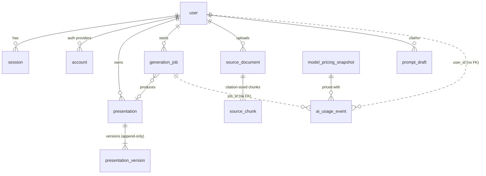

# Data model (Phase 1–2)

| Table | Purpose / key decisions |
|---|---|
| `user`, `session`, `account`, `verification` | Better Auth. `user.role` is server-controlled. |
| `prompt_draft` | Landing prompt → editor handoff. Single-use, 30 min TTL, claimed atomically (ADR-006). |
| `presentation` | Ownership + title + `latest_version`. Soft delete (`deleted_at`). |
| `presentation_version` | **Canonical document JSON** (`jsonb`, validated by `presentationSchema`). Every save = new row → version recovery. Slides live *inside* the document, not as rows: a deck is read/written as a unit and AI edits are patches to the document. |
| `generation_job` | Async job: status machine, `progress`, `checkpoint` (stage outputs for resume), `idempotency_key` (unique per user), lease (`locked_until`), `attempts`. |
| `ai_usage_event` | **Append-only ledger** (DB trigger blocks UPDATE/DELETE). One row per model *attempt*, success or error: provider, model, version, tokens (in/cached/out/reasoning), images, latency, USD cost, `pricing_snapshot_id`, environment, `credit_cost` (filled in Phase 5). `user_id`/`job_id` are deliberately **not** foreign keys so history outlives users and jobs. |
| `model_pricing_snapshot` | Price at a point in time; a changed price inserts a new row, never edits. Makes historical cost reproducible and auditable vs provider invoices. |
| `source_document`, `source_chunk` | Extracted text split into ~1.5k-char chunks with locators (`p. 4`). Raw uploads are not retained yet (parsed in memory) — private S3 retention is a follow-up. |

Still to come: subscriptions/plans/credit ledger (P5), share links & export jobs (P4), analytics events (P6), audit log, templates/brand kits.

Known gap: `TRUNCATE` bypasses row triggers. In production the API's DB role must not have `TRUNCATE`/`DROP` on `ai_usage_event` (grant INSERT/SELECT only).
